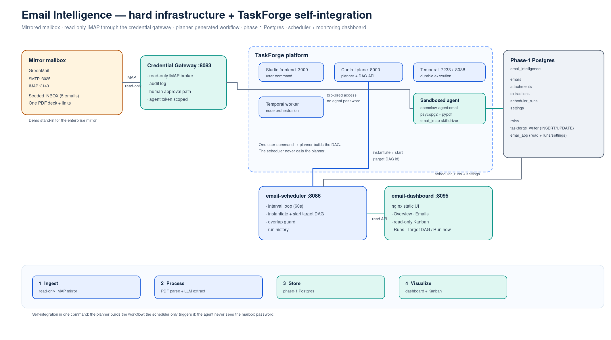

# Email Intelligence — runnable infrastructure example

This example shows the **hard infrastructure** behind the email-processing
proposal and, more importantly, how TaskForge **self-integrates** with it: one
user command is enough for the planner to build the email workflow against
services that are already running.

```
mirrored mailbox (GreenMail) → credential gateway (read-only IMAP)
    → planner-generated TaskForge DAG → phase-1 Postgres
    → scheduler (manual or interval) → monitoring dashboard + read-only Kanban
```



*(If the PNG is not present, open `taskforge-email-integration.xml` in
diagrams.net; the source has two pages: infrastructure and workflow.)*

## What is pre-provisioned

| Service | Purpose |
|---|---|
| `greenmail` | Local mirror mailbox. SMTP `3025`, IMAP `3143`, seeded INBOX, one PDF deck. |
| `email-postgres` | Phase-1 store: `emails`, `attachments`, `extractions`, `scheduler_runs`, `settings`. |
| `email-scheduler` | Manual/interval scheduler that starts the target DAG in place; read API for the dashboard. |
| `email-dashboard` | Monitoring UI: Overview, Emails, read-only Kanban, Runs, Settings. |
| `mail-seed` | One-shot seeder; sentinel-protected so repeated `up` runs do not duplicate mail. |

The TaskForge platform (Studio, control plane, Temporal, worker, sandbox,
credential gateway) is expected to be running via `make up`.

## What TaskForge builds

The operator pastes `planning-objective.txt` into Studio. The planner creates a
workflow equivalent to:

1. `list-new-emails` — read INBOX through `email_imap`, upsert `emails`.
2. `classify-intent` — `new_pitch`, `investor_thesis`, `follow_up`,
   `meeting_request`, `other`.
3. `parse-attachments` — download PDFs, extract text with `pypdf`, record
   DocSend/Drive links as metadata (never fetched).
4. `extract-structured` — company, website, sector, stage, capital, valuation,
   thesis, traction metrics, confidence.
5. `persist-extraction` — idempotent upserts into `attachments` and
   `extractions`, status moved through `new → classified → parsed → extracted
   → stored`.
6. `summarize-run` — write `/workspace/email-run-summary.json`.

There is **no curated DAG in this example** and no scheduler node inside the
workflow: the external `email-scheduler` owns manual/interval execution.

## Quick start

```bash
# 1. Platform (skip if already running; run `make restart` if you just pulled
#    this change, so the worker includes the EMAIL_DB_HOST injection)
make up

# 2. One-time on a clean machine: the email image builds FROM the base image
make build-base

# 3. Bring up the example + register the mailbox credential + import the skill
make example-up NAME=email-intelligence

# 4. Open the dashboard
xdg-open http://localhost:8095
```

`make example-up` starts the compose stack, builds `openclaw-agent:email` if
missing, imports the `Email Intelligence Pipeline` skill for that image, and
runs `scripts/bootstrap.sh` to register the read-only `taskforge-mail`
credential.

### Build the workflow from one command

**UI path (used for the presentation):**

1. Open TaskForge Studio → project **email-intelligence**.
2. Paste `planning-objective.txt`.
3. Select the **email** agent image and the **Email Intelligence Pipeline** skill.
4. Build the workflow and inspect the planner output/graph.
5. Start it once to confirm the run.

**Headless path:**

```bash
bash scripts/build-dag.sh --set-target
```

This calls the same planner API, waits for the DAG to become `ready`, prints the
DAG id, and points the scheduler at it.

### Point the scheduler at the DAG

After the DAG exists, either:

- paste its id into the dashboard **Settings → Target DAG** field, or
- run `bash scripts/set-target.sh <dag-id>`.

The scheduler defaults to **Manual only**: it will not run until you press
**Run now**. Switch to **Interval** in Settings if you want automatic processing;
the first automatic run happens after the configured interval, and the Overview
panel shows the next run time. Both modes start the target DAG in place with the
same `POST /api/dags/{id}/start` used by the backoffice **Run (all)**; they do not
create a cloned DAG. Runs are recorded in `scheduler_runs`.

The DAG pipeline also writes its own audit rows to `scheduler_runs`. The
dashboard’s **Runs** tab and scheduler status only consider external scheduler
triggers where `source_dag_id = instance_dag_id = target`, so pipeline audit rows
do not appear as phantom automatic runs.

## Dashboard

`http://localhost:8095`

- **Overview** — totals, stored/failed, a prominent scheduler panel (mode, target,
  next run, last run, **Run now**), recent emails and runs.
- **Emails** — filter by status/intent; click a row for headers, body, attachments,
  parse state, extraction JSON, links.
- **Kanban** — read-only columns `New → Classified → Parsed → Extracted → Stored`
  plus `Failed`.
- **Runs** — manual/interval triggers, target DAG, timings, errors.
- **Settings** — Manual/Interval mode selector, interval, target DAG id, health,
  **Run now**.

## Inject a synthetic batch

The mirror mailbox can be topped up at any time without touching the seeded
five messages:

```bash
# random batch of 5-10
python3 scripts/inject_synthetic_emails.py

# fixed batch
python3 scripts/inject_synthetic_emails.py --count 7

# deterministic content and Message-IDs (re-run to test duplicate suppression)
python3 scripts/inject_synthetic_emails.py --seed 42 --count 5

# no PDF attachments
python3 scripts/inject_synthetic_emails.py --count 5 --no-attachments

# preview only
python3 scripts/inject_synthetic_emails.py --count 5 --dry-run
```

The script sends over SMTP to `127.0.0.1:3025` (GreenMail, no auth) and creates
a one-page PDF in memory for each `new_pitch` message, so no extra Python
package is required. After injecting, press **Run now** in the dashboard, or use
**Interval** mode if you want automatic runs. The workflow de-duplicates by
`Message-ID`, so re-running with the same `--seed` is a safe duplicate-suppression
test.

The gateway scans at most 50 `INBOX` messages per run; keep the test mailbox
below that limit.

## Verify

```bash
bash scripts/verify.sh
REQUIRE_DATA=1 bash scripts/verify.sh   # after running the DAG at least once
```

Checks containers, schema, the least-privilege role (DELETE/DDL denied), mailbox
seed count, credential registration, scheduler health, dashboard HTTP, and
optionally pipeline data.

## Configuration

Copy `.env.example` to `.env` to override defaults.

| Variable | Default | Meaning |
|---|---|---|
| `SCHEDULER_MODE` | `manual` | `manual` = only **Run now**; `interval` = automatic starts. |
| `INTERVAL_SECONDS` | `60` | Interval for automatic mode (10–86400 seconds); ignored in manual mode. |
| `SCHEDULER_POLL_SECONDS` | `5` | How often the scheduler loop checks the mode/next-run state. |
| `TARGET_DAG_ID` | empty | Initial target; the dashboard/`settings` table wins once set. |
| `PLATFORM_NETWORK` | `openclaw-contained_openclaw-network` | External Docker network. |
| `TASKFORGE_WRITER_PASSWORD` | demo value | Agent DB role password. Changing it also requires rebuilding the `email` image (the demo password is baked there) or injecting `EMAIL_DB_PASSWORD` into agent runs. |
| `EMAIL_APP_PASSWORD` | demo value | Backend DB role password. |

## Files

```
examples/email-intelligence/
├── README.md
├── example.yaml
├── planning-objective.md / planning-objective.txt
├── docker-compose.yml
├── .env.example
├── taskforge-email-integration.xml        # draw.io, 2 pages
├── taskforge-email-integration.svg        # vector source used for the PNG
├── config/skills/email-pipeline.*          # v2 skill + bundled email_imap driver
├── docs/architecture-diagram.md
├── docs/demo-runbook.md
├── init-db/                                # schema + least-privilege roles
├── backend/                                # FastAPI scheduler + read API
├── frontend/                               # nginx static dashboard
├── mail-seed/                              # one-shot GreenMail seeder
└── scripts/                                # bootstrap/build-dag/set-target/verify/reset/inject-synthetic-emails
```

## Demo runbook

See [`docs/demo-runbook.md`](docs/demo-runbook.md) for the screenshot-by-screenshot
presentation flow.

## Troubleshooting

- **Dashboard shows `degraded`** — check `docker logs email-scheduler`; the
  control plane or Postgres may not be reachable.
- **Credentials page shows no `taskforge-mail`** — run `bash scripts/bootstrap.sh`.
- **`build-dag.sh` says the skill is missing** — run `make example-up
  NAME=email-intelligence` again, or check `docker logs control-plane`.
- **The DAG has no `email` image** — the profile is synced by
  `make example-up`; confirm with the Agent Images page, then re-plan.
- **Agent cannot reach the database** — the worker injects the resolved
  `email-postgres` IP as `EMAIL_DB_HOST`; recreate the worker after updating the
  code (`make restart`).
- **Mailbox is empty** — `bash scripts/reset.sh` re-seeds it.
- **No scheduler runs** — set a target DAG id in Settings; the default mode is
  **Manual only**, so press **Run now** or switch to **Interval** for automatic runs.

## Production notes

This is a demo. Harden before production:

- Do not bake DB passwords into images; inject them from a secret store.
- Use TLS for IMAP and Postgres.
- Keep the agent role least-privilege (the example already denies DELETE/DDL).
- Replace the local mirror with the enterprise mailbox mirror and keep the
  credential-gateway approval/audit path.
- Add retry/backoff and alerting around scheduler runs.
- Phase 2: vector search, interactive Kanban, and external deck fetching.
