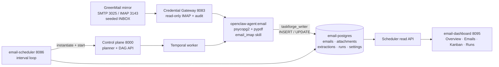
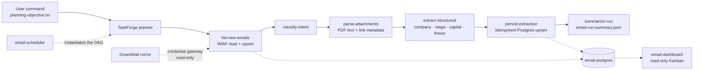

# Architecture walkthrough

The editable source is [`../taskforge-email-integration.xml`](../taskforge-email-integration.xml)
(two pages). Export it to `taskforge-email-integration.png` from diagrams.net
for the presentation.

## Page 1 — hard infrastructure

The example deliberately separates the **platform** from the **example
services**:

- **Mirror mailbox** — GreenMail with a seeded INBOX. It stands in for the
  enterprise mirror mailbox; SMTP is only used to inject demo mail.
- **Credential gateway** — the agent never receives the mailbox password. It
  calls the gateway with its task token; the gateway reads IMAP, enforces
  read-only operations, audits access, and can require human approval.
- **TaskForge platform** — Studio creates the objective; the control plane
  plans the DAG; Temporal and the worker execute nodes; agents run on
  `openclaw-agent:email` (psycopg2 + pypdf + the bundled `email_imap` driver).
- **Phase-1 Postgres** — `email_intelligence` schema with five tables and two
  roles: `taskforge_writer` (INSERT/UPDATE on pipeline tables only) and
  `email_app` (read everything, write scheduler state only).
- **Scheduler** — a small FastAPI service with an interval loop. It reads the
  target DAG id from `settings`/`TARGET_DAG_ID`, instantiates the DAG, starts it,
  guards against overlapping runs, and records `scheduler_runs`.
- **Dashboard** — nginx static frontend; `/api/*` is proxied to the scheduler.
  It renders Overview, Emails, a read-only Kanban, Runs, and Settings.

## Page 2 — planner-generated workflow

The only workflow input is the user command. The planner chooses the `email`
image and binds the `Email Intelligence Pipeline` skill, which contains the
schema, upsert SQL, status contract, PDF parsing, link rules, and safety rules.
The scheduler is intentionally outside the DAG.

## Key properties to call out in the presentation

1. **Drop-in integration** — the platform does not own the mailbox, database,
   scheduler, or dashboard; it builds a workflow that uses them.
2. **Self-integration** — the planner generates the DAG from the objective; no
   hand-curated workflow is imported.
3. **Credential isolation** — the agent never sees the mailbox password; the
   gateway brokers read-only IMAP.
4. **Least privilege** — the agent role cannot DELETE, run DDL, or read scheduler
   settings.
5. **Deterministic operations** — the scheduler only instantiates the chosen DAG;
   the planner is not called on every interval.
6. **Observability** — every email, attachment, extraction, and scheduler run is
   visible in the dashboard and in Postgres.
